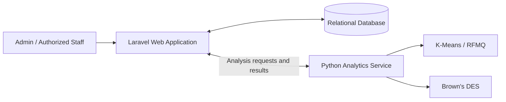

# SR12 — Product Segmentation & Sales Forecasting

**A web-based system for product segmentation using K-Means Clustering and sales forecasting using Brown's Double Exponential Smoothing (DES).**

SR12 is an undergraduate thesis project that integrates a **Laravel web application** with a **Python analytics service**. It helps users manage sales-related data, group products based on RFMQ characteristics, forecast sales, and review analysis results through a single interface.

> **Project status:** Academic project. The repository is intended to publish application source code without private sales data or local credentials.

## Table of Contents

- [Key Features](#key-features)
- [Analytical Methods](#analytical-methods)
- [Technology Stack](#technology-stack)
- [System Architecture](#system-architecture)
- [Repository Structure](#repository-structure)
- [Getting Started](#getting-started)
- [Running the Tests](#running-the-tests)
- [Screenshots](#screenshots)
- [Notes](#notes)
- [Author](#author)

## Key Features

- **Authentication and access control:** login, user management, and access permissions for application features.
- **Product management:** manage product information and stock.
- **Sales transaction management:** browse, update, and import sales transaction details.
- **Product segmentation:** process product characteristics using RFMQ and K-Means Clustering, and view segmentation results.
- **Forecasting parameter management:** manage and calibrate DES smoothing parameters.
- **Sales forecasting:** generate forecasts for an entire selected product cluster **or for an individual product within a cluster**.
- **Reporting:** view segmentation and forecasting reports, including PDF-oriented report views.
- **Data export and testing:** supporting export functionality and automated tests for application and analytics components.

## Analytical Methods

### RFMQ and K-Means Clustering

Product segmentation uses four RFMQ attributes:

| Attribute | Description |
| --- | --- |
| **R — Recency** | How recently a product was sold. |
| **F — Frequency** | How often a product appeared in sales transactions. |
| **M — Monetary** | The monetary value of product sales. |
| **Q — Quantity** | The quantity of units sold. |

K-Means Clustering groups products according to these attributes. The research configuration uses **three clusters**, with equal weighting across the four RFMQ attributes.

### Brown's Double Exponential Smoothing

Brown's DES is used to forecast sales based on historical monthly data. The research design uses **36 months of historical observations**, divided into **28 months for training** and **8 months for testing**.

Smoothing parameter (alpha) candidates are evaluated over the range **0.01–0.99**; parameter selection is based on training-set **Weighted Absolute Percentage Error (WAPE)**. Training and testing results are evaluated separately. This helps distinguish parameter fitting performance from evaluation on held-out periods.

The application provides two forecasting scopes:

1. **Cluster-level forecasting:** forecast sales for the selected product group.
2. **Product-level forecasting:** forecast sales for one selected product in that group.

## Technology Stack

| Layer | Technologies |
| --- | --- |
| Web application | PHP, Laravel, Blade templates |
| Frontend assets | JavaScript, CSS, Vite |
| Analytics service | Python, FastAPI |
| Database | MySQL / compatible relational database |
| Dependency management | Composer, npm, pip |
| Automated testing | Laravel/Pest-based test suite, Python tests |

Specific dependency versions are defined in `laravel-app/composer.json`, `laravel-app/package.json`, and `analytics-service/requirements.txt`.

## System Architecture



Laravel handles the user interface, access control, application workflows, and database interactions. The Python service carries out analytical computations requested by the web application.

## Repository Structure

```text
sr12-sales-analytics/
├── .gitignore
├── README.md                 # Main project documentation
├── analytics-service/       # Python analytics API
│   ├── app/
│   │   ├── domain/          # DES calculations
│   │   ├── schemas/         # Request/response schemas
│   │   ├── services/        # Analytical services
│   │   └── main.py          # Application entry point
│   ├── requirements.txt
│   ├── requirements-dev.txt
│   └── tests/
└── laravel-app/             # Laravel web application
    ├── app/
    ├── config/
    ├── database/
    ├── docs/
    ├── public/
    ├── resources/
    ├── routes/
    ├── tests/
    ├── composer.json
    └── package.json
```

## Getting Started

### Prerequisites

Install PHP and Composer, Node.js and npm, Python and pip, and a local MySQL-compatible database. On Windows, a local development environment such as Laragon can be used.

### 1. Clone the repository

```bash
git clone https://github.com/fedopradipa/sr12-sales-analytics.git
cd sr12-sales-analytics
```

### 2. Configure the Laravel application

```bash
cd laravel-app
composer install
cp .env.example .env
php artisan key:generate
npm install
```

Configure the database connection and the analytics-service connection in `laravel-app/.env` according to the application's actual configuration. **Do not commit your populated `.env` file.**

For a **new, empty development database**, apply the application's migrations:

```bash
php artisan migrate
```

> **Data safety:** Back up any existing SR12 database before running migrations or seeders. Do not run setup commands against your research or production database without checking their effects.

Start the web application and frontend asset server in separate terminals:

```bash
# From laravel-app/
php artisan serve
```

```bash
# From laravel-app/
npm run dev
```

### 3. Configure the Python analytics service

From the repository root:

```bash
cd analytics-service
python -m venv .venv
```

Activate the virtual environment for your shell:

```bash
# Windows Git Bash
source .venv/Scripts/activate

# macOS / Linux: use instead
# source .venv/bin/activate
```

Install Python dependencies:

```bash
pip install -r requirements.txt
```

For a standard FastAPI application exposing `app` in `app/main.py`, the development command is:

```bash
python -m uvicorn app.main:app --reload
```

Ensure the Python service's host and port match the URL configured for Laravel. **Confirm the correct analytics-service environment variables and port from the source configuration before first use.**

## Running the Tests

**Laravel tests** (from `laravel-app/`):

```bash
php artisan test
```

**Python tests** (from `analytics-service/`, after activating the virtual environment):

```bash
pip install -r requirements-dev.txt
python -m pytest
```

These commands run the available test suites; they are not a claim that every test has passed in a fresh environment.

## Screenshots

Screenshots of the dashboard, product segmentation, DES calibration, forecasting, and reports will be added to this section. Keep screenshots free of private customer, sales, or account information.

## Notes

- This repository is intended for academic documentation and portfolio presentation.
- The segmentation and forecasting methodology should be interpreted in the context of the project dataset and research setup; no universal forecasting-accuracy claim is made.
- Historical data, database exports, secrets, and local environment files should not be published without review.
- Before treating this README as a verified deployment guide, confirm the PHP/Python versions, environment variable names, and analytics API port against the final source code.

## Author

Developed by [@fedopradipa](https://github.com/fedopradipa) as an undergraduate thesis project.
