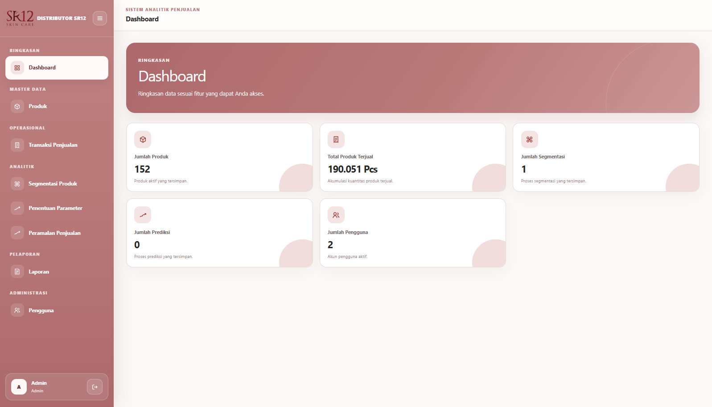
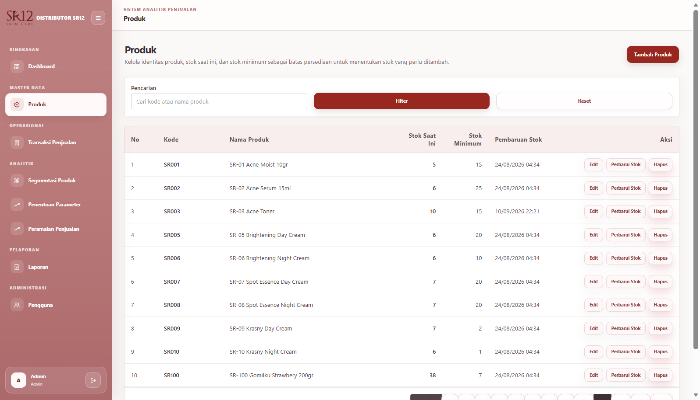
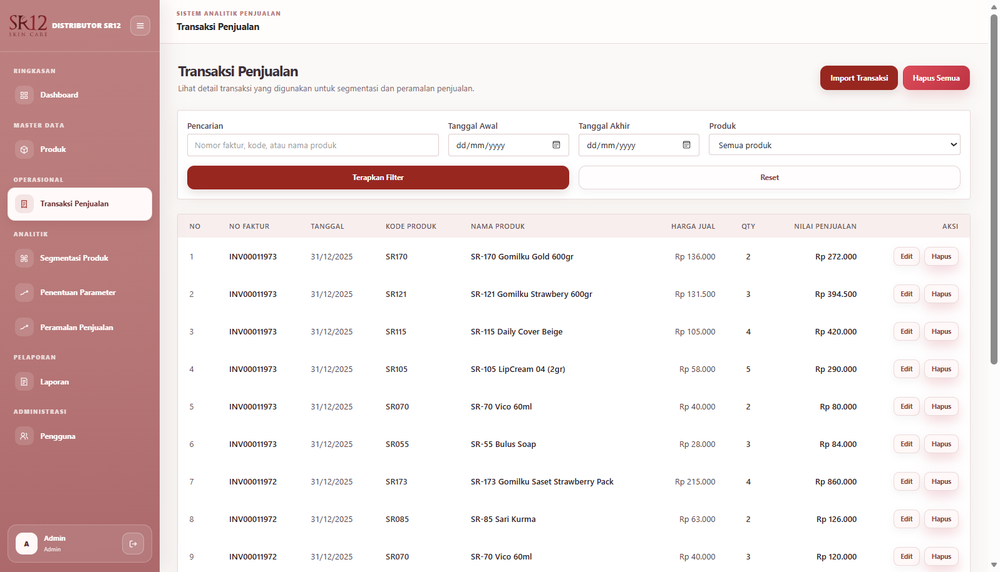
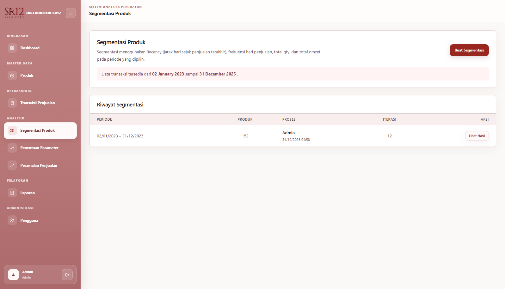
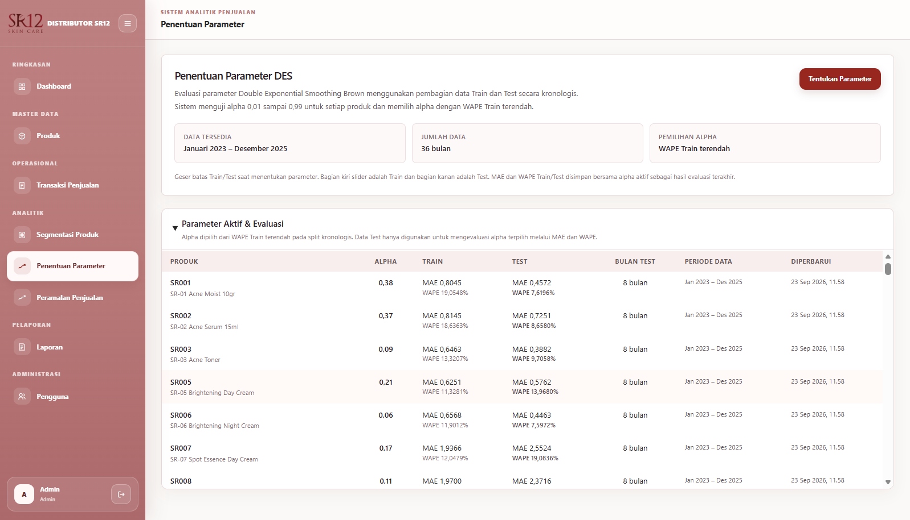
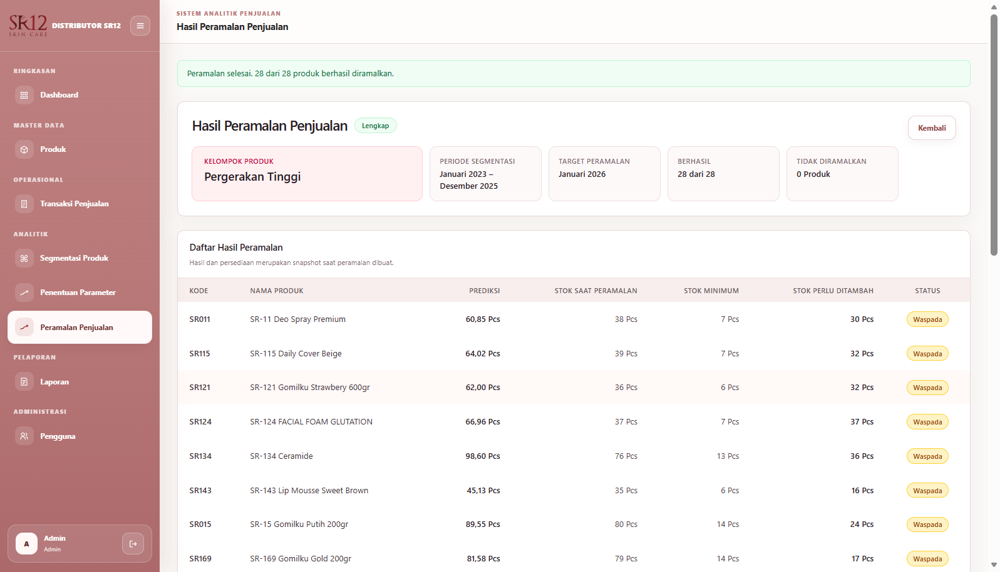
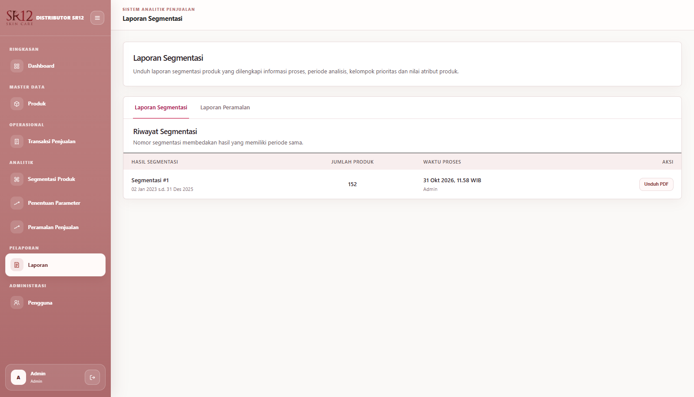
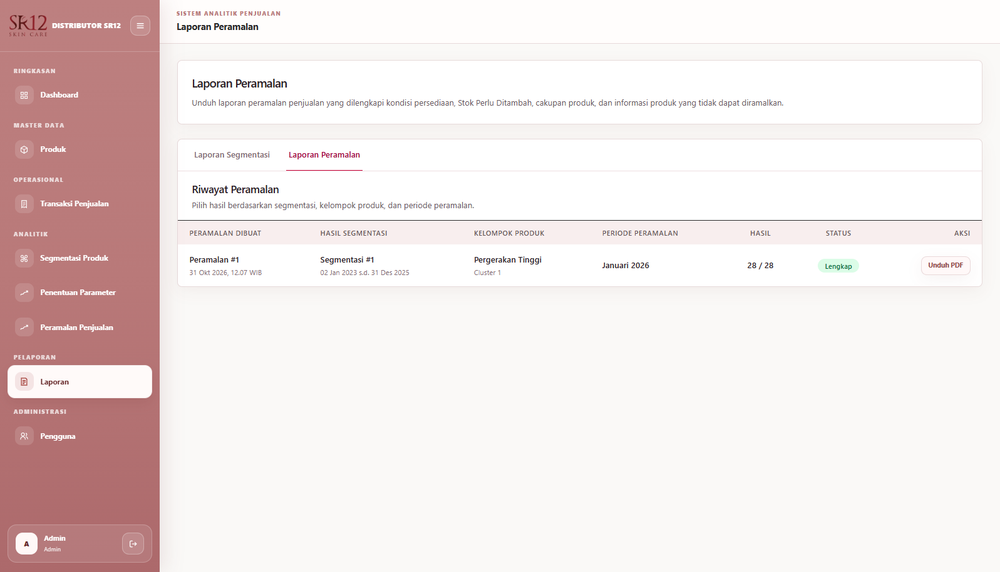
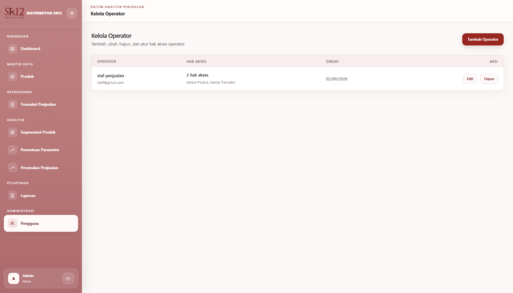
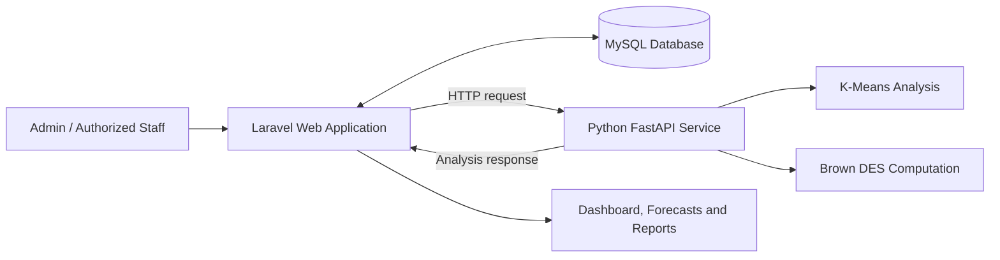

<div align="center">


# SR12 — Product Segmentation & Sales Forecasting

**A web-based product segmentation and sales forecasting system using RFMQ, K-Means Clustering, and Brown's Double Exponential Smoothing.**

[](https://laravel.com/)
[](https://www.php.net/)
[](https://www.python.org/)
[](https://fastapi.tiangolo.com/)
[](https://www.mysql.com/)
[](#analytical-methods)
[](#analytical-methods)

</div>

---

<div align="center">

## Overview

SR12 is a web-based information system developed as an undergraduate thesis project. The application supports product and sales transaction management, **product segmentation using RFMQ and K-Means Clustering**, and **sales forecasting using Brown's Double Exponential Smoothing (DES)**.

The system combines a **Laravel web application** with a **Python FastAPI analytics service**. Laravel manages the user interface, business workflows, access control, and database operations, while FastAPI processes analytical requests.

</div>

---

## Table of contents

- [Features](#features)
- [Application screenshots](#application-screenshots)
- [Tech stack](#tech-stack)
- [How it works](#how-it-works)
- [Analytical methods](#analytical-methods)
- [Project structure](#project-structure)
- [Getting started](#getting-started)
- [Configuration](#configuration)
- [API reference](#api-reference)
- [Testing](#testing)
- [Data and security notes](#data-and-security-notes)
- [Author](#author)

## Features

| Module | Description |
| --- | --- |
| Dashboard | Provides a summary of application and sales information. |
| Product management | Manages product records and inventory/stock information. |
| Sales transactions | Displays, imports, and manages sales transaction details. |
| K-Means segmentation | Segments products using Recency, Frequency, Monetary, and Quantity (RFMQ). |
| DES parameter management | Manages smoothing parameters and supports parameter calibration. |
| Sales forecasting | Forecasts sales for a selected cluster **or an individual product within that cluster**. |
| Segmentation and forecasting reports | Displays analytical reports and supports report-oriented output, including PDF views. |
| User and permission management | Manages users and feature-level access permissions. |

## Application screenshots

The following screenshots were captured from the running SR12 application. They illustrate its management, segmentation, parameter evaluation, forecasting, and reporting workflows.

<div align="center">

### Dashboard



*Dashboard — application summary and sales information.*

</div>

### Data management

<table>
  <tr>
    <th align="center" width="50%">Product management</th>
    <th align="center" width="50%">Sales transactions</th>
  </tr>
  <tr>
    <td align="center"></td>
    <td align="center"></td>
  </tr>
</table>

### Product analytics

<table>
  <tr>
    <th align="center" width="50%">K-Means segmentation</th>
    <th align="center" width="50%">DES parameter selection and evaluation</th>
  </tr>
  <tr>
    <td align="center"></td>
    <td align="center"></td>
  </tr>
</table>

<div align="center">

### Sales forecasting



*Forecast results for a selected product group, including sales predictions and stock-related information.*

</div>

### Analytics reports

<table>
  <tr>
    <th align="center" width="50%">Segmentation report</th>
    <th align="center" width="50%">Forecasting report</th>
  </tr>
  <tr>
    <td align="center"></td>
    <td align="center"></td>
  </tr>
</table>

<div align="center">

### Operator and access management



*User management and feature-level permissions.*

</div>

## Tech stack

| Layer | Technology | Role |
| --- | --- | --- |
| Backend web application | PHP 8.3, Laravel 13 | Authentication, workflows, data access, and reporting. |
| Web interface | Blade, CSS, JavaScript | Application pages and interactions. |
| Frontend tooling | Vite, npm | Asset compilation and development tooling. |
| Analytics service | Python 3.11, FastAPI, Uvicorn | HTTP API for analytical computations. |
| Analytical computation | NumPy, scikit-learn | Numeric processing and clustering. |
| Database | MySQL | Stores users, products, transactions, parameters, and analytical results. |
| Dependency management | Composer, npm, pip | Installs application dependencies. |

The version numbers above reflect the environment used for the documented installation test; consult `composer.lock`, `package-lock.json`, and `requirements.txt` for the dependency definitions in your checkout.

## How it works



1. Users manage products, sales transactions, and analytical operations through the Laravel application.
2. Laravel retrieves the required data from MySQL and prepares an analysis request.
3. The FastAPI service performs the analytical computation and returns the result.
4. Laravel validates, displays, and, where applicable, stores the result for reporting.

**Validated local ports:** Laravel uses `http://127.0.0.1:8000`, while FastAPI uses `http://127.0.0.1:8010`. The K-Means integration was exercised successfully through `POST /api/kmeans/analyze` (HTTP 200). Other analytical functions should be tested independently.

## Analytical methods

### RFMQ and K-Means Clustering

Product segmentation is based on four attributes:

| Attribute | Description |
| --- | --- |
| **R — Recency** | How recently a product was sold. |
| **F — Frequency** | Frequency of product sales. |
| **M — Monetary** | Monetary value of product sales. |
| **Q — Quantity** | Number of units sold. |

The thesis configuration uses **three clusters** and gives the four RFMQ attributes equal weighting. The K-Means algorithm groups products based on their calculated characteristics.

### Brown's Double Exponential Smoothing (DES)

Brown's DES is used to forecast product sales from historical monthly observations. In the thesis evaluation, **36 months** are split into **28 training months** and **8 testing months**. The smoothing parameter `alpha` is explored over **0.01 to 0.99**, and forecast accuracy is evaluated using **Weighted Absolute Percentage Error (WAPE)**.

The system supports two forecasting scopes:

- **Cluster-level forecasting:** forecast the sales of a selected product cluster.
- **Individual product forecasting:** forecast the sales of a selected product within a cluster.

The research-specific evaluation configuration describes the thesis methodology; it is not a claim that the system always achieves a particular error threshold on arbitrary datasets.

## Project structure

```text
sr12-sales-analytics/
├── analytics-service/           # Python FastAPI analytics service
│   ├── app/
│   │   ├── domain/              # Core analytical routines
│   │   ├── schemas/             # API request/response schemas
│   │   ├── services/            # K-Means and DES services
│   │   └── main.py              # FastAPI entry point
│   ├── requirements.txt
│   ├── requirements-dev.txt
│   └── tests/
├── laravel-app/                 # Laravel web application
│   ├── app/                     # Controllers, models, and services
│   ├── config/                  # Application configurations
│   ├── database/                # Migrations, factories, and seeders
│   ├── public/                  # Public assets and project logo
│   ├── resources/               # Blade views, CSS, and JavaScript
│   ├── routes/                   # Application routes
│   ├── tests/
│   ├── composer.json
│   └── package.json
├── docs/
│   └── screenshots/             # Screenshots used in this README
├── .gitignore
└── README.md
```

## Getting started

### Prerequisites

The following versions were used successfully in a Windows / Laragon installation test:

- PHP **8.3.17** and Composer **2.8.2**
- Node.js **22.14.0** and npm **10.9.2**
- Python **3.11.9** and pip
- MySQL (running locally)
- Git

These are **tested versions**, not necessarily the minimum supported versions. Check the package manifests for dependency constraints.

### 1. Clone the repository

```bash
git clone https://github.com/fedopradipa/sr12-sales-analytics.git
cd sr12-sales-analytics
```

If you clone the project using another folder name (for example, `SR12`), use that name in the subsequent commands.

### 2. Install Laravel dependencies

```bash
cd laravel-app
composer install
npm ci
npm run build
```

`npm ci` uses the committed `package-lock.json`. The frontend was successfully built with Vite in the installation test.

### 3. Create and configure the database

Start MySQL and create a **new, empty** database through your preferred MySQL tool, for example:

```sql
CREATE DATABASE db_sr12
  CHARACTER SET utf8mb4
  COLLATE utf8mb4_unicode_ci;
```

If the database already exists, **do not recreate, overwrite, or reset it**. Back up any existing research data before applying changes.

Create Laravel's environment file:

```bash
cp .env.example .env
php artisan key:generate
```

Edit `laravel-app/.env` (example for local Laragon):

```dotenv
APP_ENV=local
APP_DEBUG=true

DB_CONNECTION=mysql
DB_HOST=127.0.0.1
DB_PORT=3306
DB_DATABASE=db_sr12
DB_USERNAME=root
DB_PASSWORD=

ANALYTICS_SERVICE_URL=http://127.0.0.1:8010
```

Use the actual MySQL credentials on your machine; the empty password above is **only an example for a local development environment**. Never commit `.env`.

Apply migrations and seed the **new, empty** database:

```bash
php artisan config:clear
php artisan migrate
php artisan db:seed
```

The seeders create a development admin account and feature permissions. **Review the seeded admin credentials in `database/seeders/UserSeeder.php` and replace the default password before using the application beyond local testing.** The seeders do not populate the historical product and transaction dataset.

### 4. Install and start the Python analytics service

Open a **second terminal** from the repository root:

```bash
cd analytics-service
python -m venv .venv
```

Activate the virtual environment:

```bash
# Windows Git Bash
source .venv/Scripts/activate

# macOS / Linux (use this instead)
# source .venv/bin/activate
```

Install dependencies:

```bash
python -m pip install -r requirements.txt
python -m pip check
```

Start FastAPI on port **8010**:

```bash
python -m uvicorn app.main:app --host 127.0.0.1 --port 8010 --reload
```

- FastAPI: <http://127.0.0.1:8010>
- Interactive API documentation: <http://127.0.0.1:8010/docs>

Keep this terminal open while using analytical features.

### 5. Start the Laravel web application

Open another terminal inside `laravel-app/` and run:

```bash
php artisan serve --host=127.0.0.1 --port=8000
```

Open <http://127.0.0.1:8000> in your browser and sign in with your **local development account**.

> **Port configuration:** Laravel and FastAPI must run on different ports. Laravel's `ANALYTICS_SERVICE_URL` must match the FastAPI address; in this guide that is `http://127.0.0.1:8010`.

For frontend development with automatic asset updates, use `npm run dev` in an additional Laravel terminal. For the documented setup, `npm run build` provides built assets without requiring the Vite dev server.

## Configuration

| Setting | Location | Purpose |
| --- | --- | --- |
| `DB_CONNECTION` | `laravel-app/.env` | Database driver (`mysql`). |
| `DB_HOST`, `DB_PORT` | `laravel-app/.env` | Database server address. |
| `DB_DATABASE` | `laravel-app/.env` | Name of the SR12 database. |
| `DB_USERNAME`, `DB_PASSWORD` | `laravel-app/.env` | Database credentials. |
| `ANALYTICS_SERVICE_URL` | `laravel-app/.env` | FastAPI base URL (for example, `http://127.0.0.1:8010`). |
| `ANALYTICS_CONNECT_TIMEOUT`, `ANALYTICS_TIMEOUT` | `laravel-app/.env` (optional) | HTTP connection/request timeouts defined in Laravel configuration. |

Laravel reads the analytics configuration from `laravel-app/config/services.php`. After changing `.env`, run `php artisan config:clear` and restart the running Laravel process if required.

## API reference

The Python service exposes an HTTP API used by Laravel. The following route has been exercised during installation verification:

| Method | Endpoint | Purpose | Verification |
| --- | --- | --- | --- |
| `POST` | `/api/kmeans/analyze` | Process a K-Means analysis request. | HTTP 200 observed from Laravel → FastAPI. |

Visit the generated FastAPI documentation at <http://127.0.0.1:8010/docs> to inspect the other available endpoints and their request/response schemas. Do not assume a DES route name without checking the installed API.

## Testing

**Laravel application tests:**

```bash
cd laravel-app
php artisan test
```

**Python service tests:**

```bash
cd analytics-service
# Activate .venv first
python -m pip install -r requirements-dev.txt
python -m pytest
```

**Dependency and frontend checks:**

```bash
# In laravel-app/
npm audit
npm run build
```

These are available validation commands, **not a claim that all application and Python tests have passed**. In the documented local setup, npm audit reported zero vulnerabilities after a dependency update and the frontend build succeeded. Confirm that any local `package-lock.json` security update has been committed to your repository before assuming it is present in a fresh clone.

## Data and security notes

- This public source-code repository does **not** automatically restore the thesis dataset. Database migrations create tables; seeders create a development user and permissions, not the historical sales records.
- Research records (including the 152 products and historical transactions used during local testing) must be supplied separately if their publication is authorized.
- Do not publish `.env`, database credentials, customer information, private transaction exports, or internal backup files.
- The included development admin seeder uses a fixed sample password. Change it before any deployment outside a controlled local environment.
- `APP_DEBUG=true` is for local development only. Disable debug mode for production.
- No public deployment or performance/accuracy guarantee is implied by the screenshots or methodology description.

## Author

Developed by **[@fedopradipa](https://github.com/fedopradipa)** as an undergraduate thesis project.

## License

No license is declared in this README. Refer to a `LICENSE` file if one is added to the repository; absent a license, do not assume the source code is released under MIT or another open-source license.
